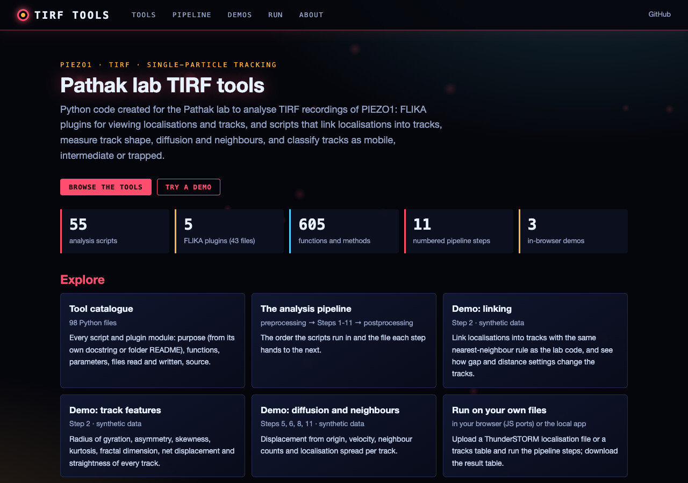
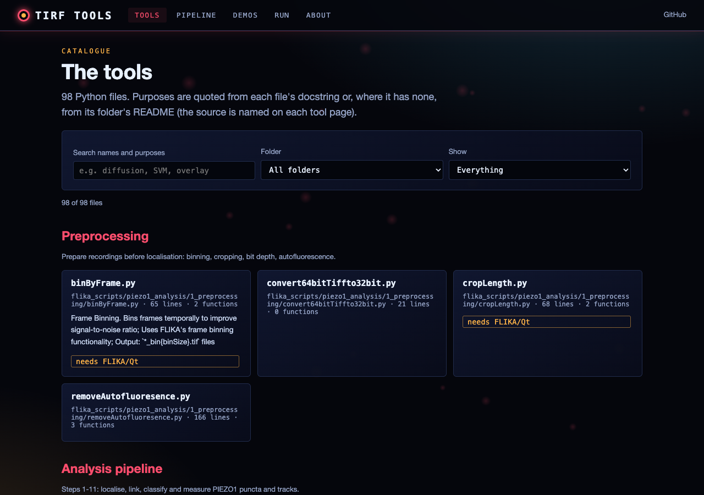
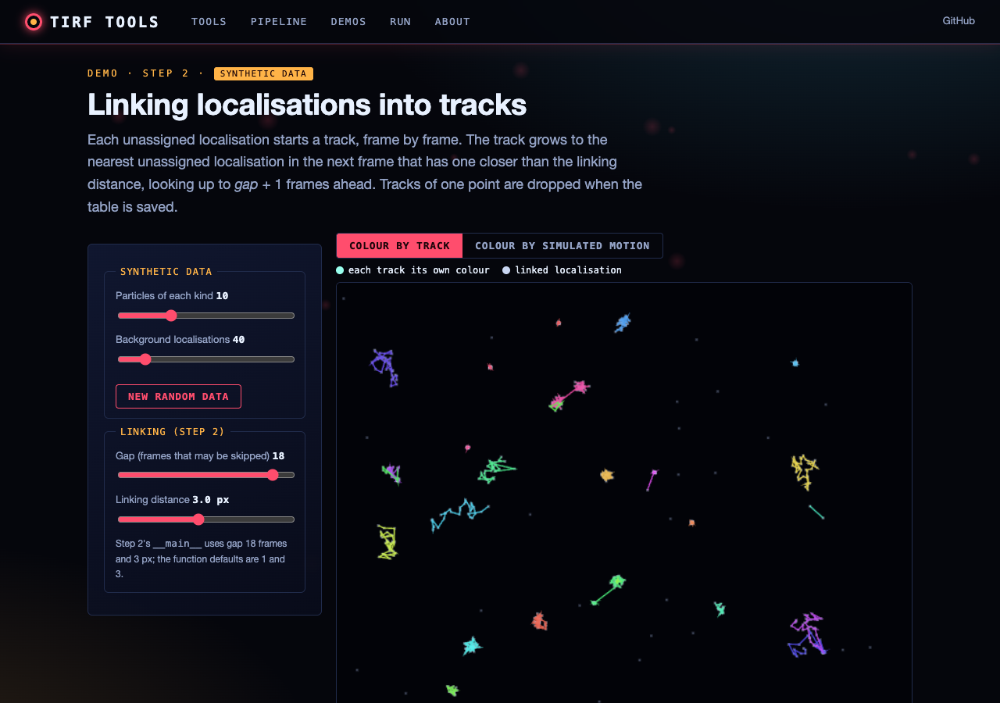
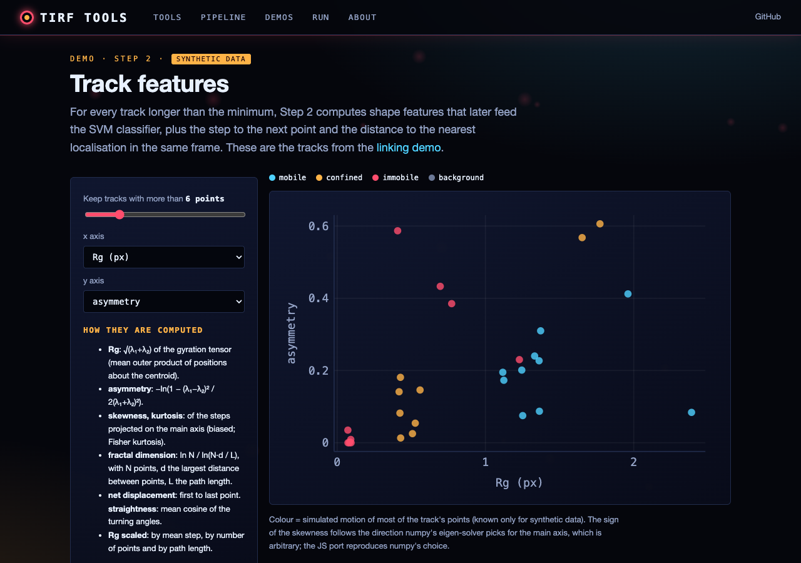

# PIEZO1-HaloTag Analysis Pipeline

This repository contains a collection of Python scripts and FLIKA plugins for analyzing PIEZO1 protein dynamics in microscopy data, as described in [Bertaccini et al. 2023](https://doi.org/10.1101/2023.12.22.573117). The tools enable tracking, visualization, and analysis of PIEZO1 protein movement and activity in various cell types. It was created to help the Pathak lab (https://www.pathaklab-uci.com/) analyse TIRF recordings of PIEZO1 using flika (https://flika-org.github.io/).

## Overview

The codebase is organized into two main components:

- `flika_plugins/`: Custom plugins for the FLIKA image processing platform, providing interactive visualization and analysis tools
- `flika_scripts/`: Command-line Python scripts for batch processing and analysis of PIEZO1 data
- `minimal_model/`: Test data with results file from running the analysis pipeline

### Key Features

- Super-resolution tracking of PIEZO1-HaloTag puncta
- Analysis of protein diffusion and mobility patterns 
- Visualization of protein localization and trajectories
- Statistical analysis of protein behavior

## Requirements

- Python 3.7+
- FLIKA (https://github.com/flika-org/flika)
- Dependencies:
  - numpy
  - pandas 
  - scipy
  - scikit-image
  - trackpy
  - PyQt5

## Installation

1. Install FLIKA following the instructions at: https://github.com/flika-org/flika

2. Clone this repository:
```bash
git clone https://github.com/gddickinson/pathak_lab.git
```

3. Install required Python packages:
```bash
pip install -r requirements.txt
```

4. Install the FLIKA plugins:
   - Copy the contents of `flika_plugins/` to your FLIKA plugins directory
   - Restart FLIKA to load the new plugins

## Usage

The analysis pipeline consists of several steps:

1. **Preprocessing** (`flika_scripts/piezo1_analysis/1_preprocessing/`)
   - Convert and prepare microscopy data
   - Bin data by frame

2. **Analysis** (`flika_scripts/piezo1_analysis/2_analysis/`)
   - Detect and track PIEZO1 puncta
   - Calculate diffusion coefficients
   - Analyze protein dynamics
   
3. **Postprocessing** (`flika_scripts/piezo1_analysis/3_postprocessing/`)
   - Statistical analysis
   - Data compilation
   - Filtering results

The analysis workflow depends on localization of PIEZO1 puncta using either the flika pynsight plugin (https://github.com/kyleellefsen/pynsight) or other localization software, such as thunderSTORM (https://zitmen.github.io/thunderstorm/), to identify fluorescent 'blobs' in every recording frame. Tracking is carried out using pynsight, and further analysis of point and track data performed on batches of localization files using the scripts. Point and track data can be displayed using the plugins.

See individual directory READMEs for instructions on each step.

## Web interface

A catalogue of the tools and in-browser demos: **https://gddickinson.github.io/pathak_lab/**

- **Tools**: every script and plugin module, with its purpose (from its own docstring or its folder's README),
  functions, default parameters, the file patterns it reads and writes, and a link to the source.
- **Pipeline**: the preprocessing, Steps 1-11 and postprocessing in order, with the file each step hands on.
- **Demos** (Steps 2, 5, 6, 8, 11) on **synthetic** data generated in the browser: linking, track features,
  diffusion/velocity, neighbour counts and localisation spread. The JS ports are tested against the Python on the same
  input (`node web/static/engines.test.mjs`, fixture from `scripts/make_engine_fixture.py`).
- **Run**: upload a ThunderSTORM localisation file or a tracks table. The local app runs the repo's own functions
  (linking, features, SVM classes, Steps 3/4/5/6/7/8/11) and returns the full result table; the static site runs the
  steps that have JS ports in your browser.

Run the web app locally:
```bash
pip install -r requirements-web.txt
python run_web.py            # http://127.0.0.1:8202
python -m pytest -q tests    # analysis regression tests + web tests
```
The example data in `minimal_model/` and the SVM training file are used by the local app only; the static site
(`python scripts/build_static.py`) contains no lab data.

| | |
|---|---|
|  |  |
|  |  |

## Documentation

- [FLIKA Plugins Guide](flika_plugins/README.md)
- [Analysis Scripts Guide](flika_scripts/README.md)
- [Analysis Pipeline Steps](flika_scripts/piezo1_analysis/2_analysis/Step_1_instruction.md)

## Contributing

We welcome contributions! Please feel free to submit a Pull Request.

## License

This project is licensed under the MIT License - see the LICENSE file for details.

## Citation

If you use this code in your research, please cite:
```
Bertaccini et al. (2023). PIEZO1-HaloTag hiPSCs: Bridging Molecular, Cellular and Tissue Imaging. 
bioRxiv 2023.12.22.573117; doi: https://doi.org/10.1101/2023.12.22.573117
```

## Contact

For questions or issues, please open an issue on GitHub or contact [george.dickinson@gmail.com].
